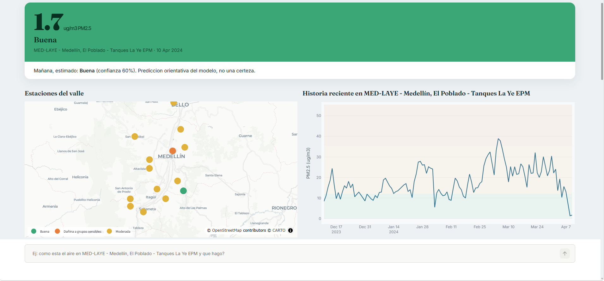
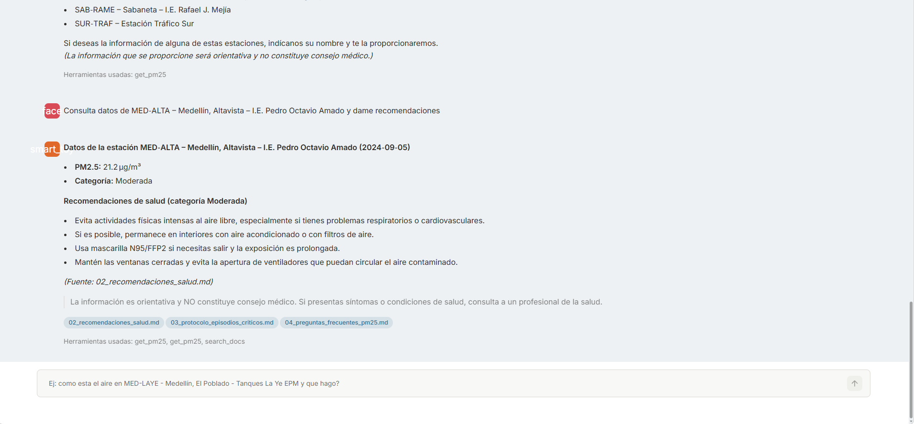

# Aire del Valle de Aburrá — Agente de calidad del aire

Proyecto Final — **SI3003 Inteligencia Artificial**, Universidad EAFIT (2026-1).

## Integrantes del equipo

| Nombre | ID estudiante |
|--------|---------------|
| Cristian Cárdenas | 1000258211 |
| Danna Carolina Mendoza Burgos | 1000258194 |
|  |  |

Una solución que combina una técnica clásica de IA implementada por el equipo
(Parte 1) con un agente LLM moderno con RAG y herramientas (Parte 2), sobre datos
reales de calidad del aire del Valle de Aburrá, todo expuesto en un dashboard
interactivo con chat.

- **Problema.** Los ciudadanos no comprenden qué significa el PM2.5 del día ni
  qué hacer al respecto.
- **Parte 1 (clásica).** Clasificador **Naive Bayes Gaussiano implementado a
  mano** (sin usar `sklearn.GaussianNB`) que predice la categoría de calidad del
  aire del día siguiente, con métrica frente a dos líneas base.
- **Parte 2 (moderna).** Agente LLM (Groq) con **loop agéntico**, **RAG** sobre
  un corpus de salud/normativa y **tres herramientas** (`get_pm25`,
  `predict_tomorrow`, `search_docs`).
- **Dashboard.** Streamlit con dos visualizaciones (mapa de estaciones + serie de
  tiempo), selección de estación/fecha y chat con el agente.

> La información es orientativa y **no constituye consejo médico**.

## Arquitectura

```
Datos reales (OpenAQ/SIATA) -> CSV, con fallback   Parte 1 (clasica)
  src/siata_api.py  ->  src/data_loader.py  ->  src/naive_bayes.py + baselines
                             |                        |
                             v                        v
Parte 2 (agente)        src/tools.py  <----  modelo entrenado (models/)
  src/rag.py (TF-IDF)  ->  get_pm25 / predict_tomorrow / search_docs
  src/agent.py (loop Groq + T_max) ----------------^
                             |
                             v
Dashboard: app.py (Streamlit) + src/viz.py + src/ui_theme.py
```

## Requisitos

- Python 3.11 o superior (probado en 3.14).
- Una clave de API de **Groq** (gratuita): https://console.groq.com/keys

## Instalación

```bash
# 1. Crear y activar un entorno virtual
python -m venv .venv
# Windows (PowerShell):
.\.venv\Scripts\Activate.ps1
# Linux/Mac:
# source .venv/bin/activate

# 2. Instalar dependencias
pip install -r requirements.txt

# 3. Configurar la clave de Groq
# Copia .env.example a .env y coloca tu GROQ_API_KEY.
```

El archivo `.env` debe contener:

```
GROQ_API_KEY=tu_clave_de_groq
GROQ_MODEL=openai/gpt-oss-20b
GROQ_MODEL_FALLBACK=openai/gpt-oss-120b
```

> Nota: usa modelos a los que tu cuenta de Groq tenga acceso. Los `openai/gpt-oss-*`
> están disponibles en el tier gratuito y soportan *tool calling*.

## Inicio rápido (lo mínimo para ver la app)

Tras instalar dependencias y configurar `.env` con `GROQ_API_KEY`:

```bash
streamlit run app.py
```

Eso basta: el dashboard carga los datos reales incluidos en el repositorio
(`data/raw/siata_real.csv`) y, si el modelo no está entrenado, lo entrena
automáticamente la primera vez. El chat necesita la `GROQ_API_KEY`; el resto del
dashboard (mapa, serie, predicción) funciona sin conexión.

## Capturas

Vista general: tarjeta del PM2.5 del día con su categoría y la predicción de
mañana, mapa de las estaciones coloreadas por calidad del aire y serie de tiempo
con bandas de umbral.



Chat con el agente: consulta el PM2.5 de una estación, entrega recomendaciones de
salud, cita las fuentes del corpus y muestra las herramientas usadas.



## Cómo ejecutar (paso a paso)

### 1. (Opcional) Verificar el acceso a datos
```bash
python scripts/verificar_acceso_datos.py
```
Genera `docs/verificacion_acceso_datos.md`. El sistema usa por defecto históricos
locales en CSV (plan B), así que **no requiere red para funcionar**.

### 2. Entrenar el modelo de la Parte 1
```bash
python -m src.train
```
Imprime las métricas (Naive Bayes vs líneas base) y guarda el modelo en `models/`.

### 3. Lanzar el dashboard
```bash
streamlit run app.py
```
Abre el navegador en la URL que indica Streamlit (por defecto
http://localhost:8501). Selecciona estación y día, explora el mapa y la serie, y
conversa con el asistente.

### 4. (Opcional) Evaluar el agente
```bash
python -m eval.agent_eval
```
Ejecuta las 12 preguntas de prueba y genera el reporte en
`eval/resultados/`.

### 5. (Opcional) Notebook de EDA y Parte 1
Abre `notebooks/01_eda_parte1.ipynb` en Jupyter.

## Datos

Fuente real: **SIATA** (Sistema de Alerta Temprana del Valle de Aburrá). El
proyecto usa **datos reales** de PM2.5 diario de 24 estaciones del Valle de
Aburrá, descargados vía **OpenAQ** (agrega la red oficial de Medellín).

Para regenerar los datos reales (requiere una API key gratuita de OpenAQ en
`.env` como `OPENAQ_API_KEY`, obtenida en https://explore.openaq.org/register):

```bash
python scripts/descargar_datos_openaq.py   # crea data/raw/siata_real.csv
```

Si `siata_real.csv` existe, el sistema lo usa por defecto; si no, cae al dataset
sintético `data/raw/siata_sample.csv` (reproducible, sin descargas). Ver
`data/README.md` para el detalle de columnas y fuentes.

> **Nota sobre la actualidad de los datos.** El proyecto trabaja con un
> **histórico descargado** (plan B del enunciado), no con datos en tiempo real.
> SIATA no expone una API REST pública y estable con series históricas diarias;
> la vía programática usada es OpenAQ, que requiere API key y entrega PM2.5 pero
> **no** meteorología. Por eso el CSV incluido tiene una fecha de corte (no es el
> día de hoy) y el dashboard muestra el "último día disponible" de cada estación,
> que corresponde a esa descarga. Para actualizarlo basta volver a correr
> `scripts/descargar_datos_openaq.py`. Esta decisión prioriza la
> reproducibilidad: la demo corre igual aunque la red o la API fallen.

## Pruebas

Con el entorno virtual activado:

```bash
pytest -q
```

Resultado esperado: **58 pruebas pasan**. No consumen la API de Groq (el agente
se prueba con un cliente simulado), así que corren sin conexión ni gastar cuota.
Cubren la categorización ICA, el cliente de datos con fallback, la correctitud
del Naive Bayes (comparado contra `sklearn.GaussianNB`), el RAG, las herramientas,
el loop del agente y las figuras del dashboard.

## Resultados (Parte 1)

Sobre **datos reales** (31.457 registros, 24 estaciones), split temporal 80/20:

| Modelo                              | Accuracy | F1 macro |
|-------------------------------------|----------|----------|
| Naive Bayes (propio)                | 0.749    | **0.572** |
| Línea base: clase mayoritaria       | 0.787    | 0.220    |
| Línea base: persistencia (hoy=mañana)| 0.794   | 0.488    |

El Naive Bayes supera a ambas líneas base en **F1 macro** (la métrica relevante
con clases desbalanceadas: detecta mejor los días de mala calidad del aire). En
accuracy queda por debajo de la persistencia, una línea base fuerte en series
temporales. Ver análisis en `docs/informe.md`.

## Evaluación del agente

12 preguntas fijas (ver `eval/preguntas.py`). En la última corrida: **12/12** de
herramienta correcta y **6/7** de citación en los casos que debían citar. Reporte
completo en `eval/resultados/`.

## Limitaciones

- Las clases de calidad del aire están desbalanceadas (predominan días
  buenos/moderados); por eso el modelo se evalúa con F1 macro.
- Los datos reales de OpenAQ no incluyen meteorología (temperatura, viento,
  lluvia); el modelo usa solo señales derivadas del PM2.5. Combinar con datos de
  IDEAM es trabajo futuro.
- El Naive Bayes no supera a la persistencia en *accuracy* (sí en F1 macro): la
  persistencia es una línea base fuerte en series de calidad del aire.
- El agente a veces da recomendaciones sin consultar el corpus (ver la pregunta
  que falló la citación); es un área de mejora del *prompt*.
- **No es una herramienta clínica ni de consejo médico.**

## Estructura

```
app.py                      Dashboard Streamlit
src/                        Modulos (datos, modelo, RAG, agente, viz, tema)
corpus/                     Documentos para el RAG
data/                       CSV de muestra + instrucciones de datos
eval/                       Evaluacion del agente (preguntas + reporte)
notebooks/                  EDA y Parte 1
scripts/                    Utilidades (generar datos, verificar acceso, probar agente)
tests/                      Pruebas (pytest)
docs/                       Verificacion de acceso, informe, declaracion de IA
.kiro/skills/               Skill de diseño frontend usada para el dashboard
```

## Guía de revisión (dónde está cada requisito)

Para facilitar la evaluación sin sustentación, esto mapea cada requisito del
enunciado a su ubicación en el repositorio:

| Requisito | Dónde verlo |
|-----------|-------------|
| Datos reales, documentados y citados | `data/README.md`, `docs/verificacion_acceso_datos.md`, `data/raw/siata_real.csv` |
| Verificación de acceso en 48h + plan B | `scripts/verificar_acceso_datos.py`, `src/siata_api.py` |
| Parte 1 implementada por el equipo | `src/naive_bayes.py` (sin `sklearn.GaussianNB`) |
| Métrica vs línea base | `src/train.py`, `src/baselines.py`, `models/reporte_parte1.txt` |
| Agente LLM con loop y RAG | `src/agent.py`, `src/rag.py` |
| ≥2 herramientas con manejo de errores | `src/tools.py` (3 herramientas) |
| ≥2 visualizaciones | `src/viz.py` (mapa + serie), vistas en `app.py` |
| Interacción del usuario | `app.py` (selección de estación/fecha + chat) |
| Evaluación del agente (10-15 preguntas) | `eval/preguntas.py`, `eval/resultados/` |
| Informe (≤4 páginas) | `docs/informe.md` |
| Declaración de uso de IA | `docs/declaracion_uso_ia.md` |
| Reproducibilidad | este README + `requirements.txt` + `pytest` |

## Declaración de uso de IA generativa

Ver `docs/declaracion_uso_ia.md`.
